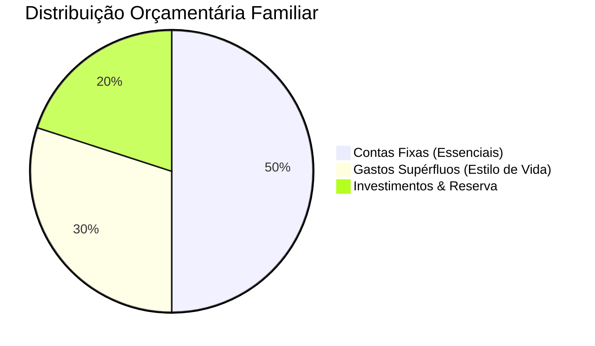

# Contexto do Projeto: Controlador Financeiro Doméstico PWA

## 1. Visão Geral
O **Controlador Financeiro Doméstico PWA** é uma aplicação web progressiva (*Progressive Web App - PWA*) projetada para fornecer gestão financeira pessoal e familiar com alta densidade visual, performance instantânea e funcionamento 100% resiliente a falhas de conectividade (*offline-first*).

O design e a experiência do usuário são orientados pelo padrão estético **Hyper Charts / Obsidian Dark Fintech**, priorizando visualizações em tempo real com gráficos matemáticos vetoriais fluidos e interatividade direta (*click-to-edit* inline).

---

## 2. Origem e Especificação
O projeto foi formalizado no documento executivo:
- **Arquivo base:** `Documento de Arquitetura e Engenharia - Antigravity.pdf`
- **Foco:** Especificação de arquitetura técnica, modelo de dados unificado, matemática de renderização gráfica nativa e roteiro evolutivo contínuo para o ecossistema Antigravity.

---

## 3. Metodologia Financeira: Regra 50-30-20
O motor de cálculo orçamentário distribui a renda familiar líquida em três classes fixas e imutáveis:

1. **50% Contas Fixas (Essenciais à Sobrevivência):**
   - Moradia (aluguel/prestação), condomínio, energia elétrica, água, alimentação básica e telecomunicações.
   - *Impacto:* Compromisso rígido mensal. Baixa prioridade de corte.

2. **30% Gastos Supérfluos (Estilo de Vida e Discricionários):**
   - Restaurantes, delivery, assinaturas de streaming, vestuário, lazer e viagens.
   - *Impacto:* Variabilidade discricionária. Alta prioridade de contenção e corte em caso de descompasso financeiro.

3. **20% Investimentos & Reserva de Emergência:**
   - Reserva de oportunidade/emergência (CDB Liquidez Diária), Tesouro Direto IPCA+, fundos imobiliários e ações.
   - *Impacto:* Construção de autonomia financeira e patrimônio de longo prazo. Preservação de aporte mínimo de 10% mesmo em cenários adversos.

---

## 4. Filosofia de Design e UX
- **Obsidian Dark Fintech:** Paleta cromática profunda (`#07080b`), acentos em verde neon/esmeralda (`#00FF87`), azul ciano e roxo sutil para indicar classes orçamentárias.
- **Edição em Linha (Click-to-Edit):** Qualquer valor monetário, categoria ou status pode ser editado diretamente na interface, dispensando formulários modais excessivos.
- **Gráficos Vivos a 60 FPS:** Renderização contínua orientada a equações senoidais e harmônicas em SVG sem bibliotecas pesadas de animação externa.
- **Offline Total e Autonomia:** O usuário pode gerenciar receitas, contas e despesas no metrô, avião ou locais sem sinal. As informações persistem de modo atômico e sincronizam em segundo plano ao reconectar.

---

## 5. Diretrizes do Ecossistema
A aplicação foi concebida para permitir expansão modular direta no ecossistema Antigravity, viabilizando:
- Parser de extratos OFX/CSV dos bancos brasileiros (Nubank, Itaú, Inter).
- Projeção de independência financeira (FIRE).
- Sincronização em nuvem privada criptografada (E2EE).
- Exportação automatizada de relatórios mensais em PDF.

---

## 6. Arquitetura de Persistência Híbrida (Local-First + Supabase Cloud)
- **Camada Local (0ms / Offline):** Todos os lançamentos, edições e cálculos do assistente de voz persistem instantaneamente no `localStorage`/Cache PWA. O usuário nunca espera requisições de rede para interagir.
- **Camada Nuvem (Supabase + PostgreSQL):** Sincronização automática em segundo plano das tabelas `perfis_orcamento` e `itens_lancamento`.
- **Segurança (RLS):** Cada conta de usuário/família tem acesso restrito exclusivamente aos seus próprios dados através de Row Level Security.
- **Tempo Real (Supabase Realtime):** Lançamentos feitos no celular de um cônjuge refletem instantaneamente no computador ou tablet do outro sem recarregar a página.
- **Migração Transparente:** Ao criar conta ou conectar pela primeira vez, os dados locais prévios são preservados e enviados para o banco de dados.

