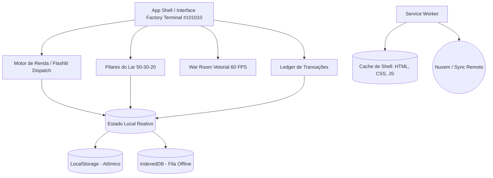

# Documentação Técnica e Arquitetura do Sistema

## Controlador Financeiro Doméstico PWA
*Documentação de engenharia de software, modelo de dados, matemática gráfica e arquitetura offline.*

---

## 1. Stack Tecnológica & Runtime de Execução

| Camada | Tecnologia | Justificativa Técnica |
| :--- | :--- | :--- |
| **Framework UI** | React 19 | Concorrência, Server/Client components, re-renders otimizados e hooks modernos. |
| **Design System** | Factory Style Reference | Terminal war room at midnight, canvas Obsidian `#101010`, dispatch card `#eeeeee`, Geist 400 e Geist Mono, zero sombras e bordas hairline de 1px. |
| **Estilização** | Tailwind CSS v4 | Sistema de design atômico com tokens nativos `@theme` e performance zero-runtime CSS. |
| **Ícones** | Lucide React | Conjunto iconográfico limpo, vetorial e de baixo peso em bundle. |
| **Persistência Primária** | LocalStorage API | Persistência atômica síncrona local para acesso imediato a dados sem latência. |
| **Fila de Mutação Offline** | IndexedDB API | Fila serializada de transações geradas quando o usuário estiver sem conexão à internet. |
| **Runtime PWA** | Service Worker + Web Manifest | Estratégia de cache híbrida (Cache-First para app shell e Stale-While-Revalidate para dados). |

---

## 2. Matriz de Atributos e Funcionalidades



| Módulo | Responsabilidade Técnica | Padrão de UX | Status |
| :--- | :--- | :--- | :--- |
| **Motor de Renda** | Cálculo dinâmico de renda líquida, saldo livre e taxa de comprometimento. | Edição direta no valor e modal rápido de ajustes de renda. | Em Produção |
| **Pilares do Lar** | Classificação tripartite: Fixas (50%), Supérfluos (30%) e Aportes (20%). | Banners com barras de saturação e deleção rápida. | Em Produção |
| **Gráficos Vetoriais** | Starburst 360° e Radar Harmônico Senoidal renderizados nativamente em SVG. | Animação contínua (Tick em 60 FPS) via `requestAnimationFrame`. | Em Produção |
| **Ledger de Despesas** | Tabela transacional com busca rápida, filtros por categoria e status de liquidação. | *Inline Click-to-Edit* com feedback visual imediato. | Em Produção |
| **PWA Offline Sync** | Cache de casca de aplicação e despacho de fila transacional no reconect. | Service Worker com cache-first e listener de rede `window.online`. | Pronto |

---

## 3. Esquema de Dados Principal (JSON Schema)

O estado da aplicação é serializável em JSON, permitindo exportação, importação e backup local.

### 3.1 Definição TypeScript dos Tipos
```typescript
export type CategoriaOrcamentaria = 'fixas' | 'superfluos' | 'investimentos';

export interface ItemLancamento {
  id: string;               // UUID v4 único
  titulo: string;           // Descrição sucinta da despesa/investimento
  categoria: CategoriaOrcamentaria;
  tipoDetalhado: string;    // Subcategoria padronizada (ex: 'Moradia', 'Streaming')
  valor: number;            // Valor monetário decimal em BRL
  vencimento: string;       // Formato textual de exibição (ex: 'Dia 10') ou ISO 8601
  pago: boolean;            // Status de liquidação da obrigação
}

export interface MetasRegra {
  fixas: number;            // Meta percentual (padrão: 50)
  superfluos: number;       // Meta percentual (padrão: 30)
  investimentos: number;    // Meta percentual (padrão: 20)
}

export interface EstadoFinanceiro {
  rendaFamiliar: number;    // Total líquido mensal disponível
  metasRegra: MetasRegra;
  itens: ItemLancamento[];
}
```

### 3.2 Exemplo Estruturado de Carga de Dados
```json
{
  "rendaFamiliar": 12500.00,
  "metasRegra": {
    "fixas": 50,
    "superfluos": 30,
    "investimentos": 20
  },
  "itens": [
    {
      "id": "item_uuid_01",
      "titulo": "Aluguel / Parcela Imobiliária",
      "categoria": "fixas",
      "tipoDetalhado": "Moradia",
      "valor": 3200.00,
      "vencimento": "Dia 10",
      "pago": true
    },
    {
      "id": "item_uuid_02",
      "titulo": "Reserva de Oportunidade (CDB)",
      "categoria": "investimentos",
      "tipoDetalhado": "Liquidez Diária",
      "valor": 1200.00,
      "vencimento": "Dia 05",
      "pago": false
    }
  ]
}
```

---

## 4. Mapeamento de Categorias e Impacto Orçamentário

A estrutura de categorias organiza os gastos familiares de acordo com o impacto no fluxo de caixa e estabelece uma hierarquia de corte orçamentário:

| Pilar | Categorias Detalhadas Sugeridas | Impacto no Fluxo de Caixa | Prioridade de Corte |
| :--- | :--- | :--- | :--- |
| **Contas Fixas** *(50%)* | Moradia, Alimentação Básica, Energia, Água, Telecomunicações, Saúde básica | Compromisso rígido mensal indispensável | **Baixa** *(Essencial à sobrevivência)* |
| **Supérfluos** *(30%)* | Restaurantes, Delivery, Assinaturas de Streaming, Vestuário, Viagens, Lazer | Variabilidade discricionária e estilo de vida | **Alta** *(Primeira linha de contenção em aperto financeiro)* |
| **Investimentos** *(20%)* | CDB Liquidez Diária, Tesouro Direto IPCA+, Ações, Fundos Imobiliários | Construção de patrimônio, reserva e autonomia futura | **Média** *(Preservar aporte mínimo prudencial de 10%)* |

---

## 5. Engenharia Gráfica e Matemática SVG

Para manter renderização suave a **60 FPS** sem dependências externas pesadas (como D3.js ou Three.js), a interface utiliza renderizadores nativos em SVG alimentados por equações trigonométricas orientadas por um ciclo contínuo de tempo (*tick*).

### 5.1 Equação dos Raios Radiais 360° (Starburst)
Cada raio $i$ do total de $N$ raios possui seu comprimento $L$ modulado pelo peso orçamentário relativo da categoria associada e por uma onda harmônica contínua:

$$\theta = \frac{i \times 360^\circ}{N}$$

$$L = \text{Base} + \left(\frac{\text{Peso}}{100} \times 36\right) + \sin\left(4\pi \times \frac{i}{N} + \text{tick}\right) \times 4$$

### 5.2 Ondas Orgânicas do Radar Harmônico Senoidal
O contorno vetorial fechado do radar gera 72 vértices interpolados em coordenadas polares, conferindo um efeito estético de "respiração líquida" do ecossistema financeiro:

$$r(\theta) = r_{\text{base}} + \sin(\theta \times \text{freq} + \text{offset}) \times \text{amplitude}$$

Conversão para o plano cartesiano bidimensional $(x, y)$:
$$x = cx + r(\theta) \times \cos(\theta)$$
$$y = cy + r(\theta) \times \sin(\theta)$$

---

## 6. Configuração PWA Manifest & Políticas de Cache

### 6.1 Manifesto de Instalação (`manifest.json`)
```json
{
  "name": "Gestor Financeiro do Lar",
  "short_name": "GestorLar",
  "start_url": "/",
  "display": "standalone",
  "background_color": "#07080b",
  "theme_color": "#00FF87",
  "icons": [
    {
      "src": "/icons/icon-192.png",
      "sizes": "192x192",
      "type": "image/png"
    },
    {
      "src": "/icons/icon-512.png",
      "sizes": "512x512",
      "type": "image/png"
    }
  ]
}
```

### 6.2 Estratégias do Service Worker
1. **Cache-First para Shell da Aplicação:**
   - Recursos estáticos (HTML principal, bundle JavaScript React, stylesheets Tailwind, fontes WOFF2 locais e ícones) são interceptados e servidos diretamente do cache local.
2. **Stale-While-Revalidate para Dados:**
   - Leituras ao storage local ocorrem instantaneamente na abertura da tela, enquanto rotinas assíncronas validam eventuais dados em background.
3. **Fila Transacional Offline via IndexedDB:**
   - Adições, edições e exclusões realizadas em modo offline são armazenadas em uma fila ordenada de mutações no IndexedDB.
   - Assim que o navegador emite o evento `window.addEventListener('online')`, a fila é descarregada e os registros são sincronizados.

---

## 7. Diretrizes de Segurança e Privacidade
- **Dados Locais por Padrão:** Todas as informações financeiras de valores e descrições residem inicialmente no dispositivo do usuário, garantindo sigilo bancário.
- **Preparação para Nuvem Segura (E2EE):** Qualquer futura camada de sincronização remota (Supabase/Firebase) deve aplicar criptografia ponta a ponta antes da transmissão.

---

## 8. Arquitetura do Assistente por Voz e Reconhecimento de Fala Contínuo

### 8.1 Ciclo de Vida do Web Speech API (`SpeechRecognition`)
O assistente `FACTORY // COPILOT_TERMINAL.SYS` opera com reconhecimento de fala contínuo e em tempo real no navegador:
1. **Instanciação Estável (`useEffect` desvinculado de estado):** O `SpeechRecognition` é configurado uma única vez na montagem do componente, impedindo que atualizações intermediárias de transcrição abortem a escuta prematuramente.
2. **Modo Contínuo (`continuous = true`, `interimResults = true`):** A escuta permanece aberta durante micro-pausas do usuário enquanto fala números e comandos complexos (ex: *"Coloque 50 de almoço"*, *"Adiciona 100 de luz e 200 de mercado"*).
3. **Detector de Silêncio Inteligente (Auto-Submit):** Um timer de inatividade de 1.8 segundos após a última palavra detectada conclui a gravação e dispara a interpretação e atualização contábil sem necessidade de cliques manuais.
4. **Reconstrução Semântica e Limpeza de Stopwords:** O módulo `aiAssistantParser` sanitiza números por extenso e comandos coloquiais (*coloque*, *anota*, *lança*, *bota*, *de*, *no*, *reais*), extraindo o título categorizado e o valor numérico com precisão estrita.

### 8.2 Resolução de Pilares com Prioridade Máxima (`detectarPilarExplicito`)
Quando o usuário menciona explicitamente o destino orçamentário no comando de voz ou texto (ex: *"como supérfluo"*, *"gasto supérfluos"*, *"nas contas fixas"*, *"no pilar investimentos"*):
1. **Prioridade de Sobrescrita:** A determinação explícita do pilar sobrepõe as associações padrão de vocabulário (por exemplo, um gasto em *"mercado"* direcionado *"como supérfluo"* é alocado em `superfluos` como *Compras Gerais*, e não em *Contas Fixas*).
2. **Remoção de Falsos Positivos por Substring:** Eliminação de buscas parciais sem limite de palavra (como a palavra *"gasto"* casando indevidamente com o radical *"gas"* de Energia), garantindo casamento estrito por limites de palavra (`\b`).
3. **Higienização de Título:** Nomes de pilares (*supérfluo*, *fixo*, *investimento*) e preposições conexas (*como*, *no*, *nas*) são expurgados do título do lançamento, resultando em descrições limpas e profissionais (ex: *"Mercado"*, *"Luz"*, *"CDB"*).

---

## 9. Mecanismo de Limpeza e Reinicialização Total do Painel (`zerarPainel`)

### 9.1 Operações de Limpeza
O sistema dispõe de rotina controlada para zerar o painel via interface ou comando de voz:
1. **Zerar Tudo (Renda e Gastos):** Redefine a renda familiar líquida para R$ 0,00 e purga todos os lançamentos do ledger local (`itens: []`), recalculando instantaneamente todos os KPIs para zero e propagando para a nuvem.
2. **Zerar Apenas Gastos:** Limpa todas as despesas e investimentos mantendo a renda líquida atual configurada.
3. **Modal de Confirmação (`ModalZerarPainel`):** Interface modal estilizada no Factory Design System com confirmação explícita de duas etapas para prevenir limpezas acidentais.
4. **Comando de Voz Integrado:** Capacidade do assistente IA interpretar frases como *"Zerar o painel"*, *"Limpar todo o painel"* ou *"Zerar tudo"*, executando a ação e fornecendo feedback falado e visual.

---

## 10. Módulo de Calendário e Planejamento Mensal (`CalendarioPlanejamentoMensal`)

### 10.1 Arquitetura e Engenharia do Planejador
O componente `CalendarioPlanejamentoMensal` implementa uma visão temporal do fluxo de caixa doméstico projetado para o mês selecionado:
1. **Navegação Temporal Universal:** Seletores de mês e ano (`<`, `Hoje`, `>`) com cálculo dinâmico da matriz de dias do mês, incluindo preenchimento dos dias pertencentes ao mês anterior e posterior para renderização de grade consistente de 7 colunas (DOM a SÁB).
2. **Parser Híbrido de Vencimentos (`extrairDiaDoVencimento`):**
   - *Datas Recorrentes:* Interpreta padrões textuais comuns como `"Dia 10"`, `"Dia 08"`, `"15"`, replicando os compromissos em todos os meses selecionados.
   - *Datas ISO 8601 e BR:* Interpreta `"AAAA-MM-DD"` e `"DD/MM/AAAA"`, vinculando obrigações exclusivamente ao ano e mês de ocorrência real.
3. **Painel de KPIs Mensais:**
   - **Total Previsto no Mês:** Soma total de todos os compromissos financeiros agendados para o mês em exibição.
   - **Quitado / Pago:** Volume financeiro já liquidado com percentual de adimplemento sobre o total previsto.
   - **Pendente a Vencer:** Montante em aberto aguardando liquidação.
   - **Pico de Vencimentos:** Identificação automática do dia de maior pressão de caixa no mês.
4. **Inspetor Interativo de Dia:** Ao clicar em qualquer data do mês, abre-se um painel de detalhes permitindo alternar status de pagamento (*pago / pendente*), deletar o item ou realizar o agendamento rápido de um novo lançamento diretamente naquela data.
5. **Filtros por Pilar e Status:** Filtragem em tempo real por pilar orçamentário (`Todos`, `Fixas`, `Supérfluos`, `Investimentos`) e status de quitação (`Pendentes`, `Quitados`).

---

## 11. Sistema de Lembretes de Vencimento via WhatsApp (`whatsappReminderService`)

### 11.1 Arquitetura e Monitoramento Temporal
O subsistema `whatsappReminderService` monitora continuamente todas as despesas e compromissos do orçamento familiar para identificar contas a vencer ou com vencimento próximo:
1. **Detecção e Cálculo de Prazos (`calcularDataVencimento` e `analisarContasParaLembrete`):**
   - *Contas que Vencem Hoje:* Contas não quitadas cuja data ou dia de vencimento coincide com o dia atual (`diasRestantes === 0`).
   - *Contas Próximas ao Vencimento:* Contas não quitadas cujo vencimento ocorrerá dentro da janela de antecedência configurada pelo usuário (padrão: 3 dias).
   - *Contas Atrasadas:* Contas não quitadas cujo dia de vencimento já transcorreu no ciclo atual.
2. **Formatação Semântica de Mensagens:**
   - *Mensagem Consolidada:* Gera resumo estruturado com marcadores de prioridade (🔴 *VENCE HOJE*, ⏰ *VENCENDO NOS PRÓXIMOS DIAS*, ⚠️ *ATRASADAS*), agrupando valor individual, pilar orçamentário (50-30-20), total previsto e chamada para liquidação no GestorLar.
   - *Mensagem Individual por Item:* Permite disparar lembrete pontual focado em uma única conta.
   - *Mensagem por Dia do Calendário:* Permite enviar a pauta completa de pagamentos de uma data específica inspecionada no calendário.
3. **Disparo Direto para API do WhatsApp:**
   - Normaliza telefones brasileiros e internacionais (`55 + DDD + número`).
   - Aciona `https://api.whatsapp.com/send` ou `https://wa.me/` com texto pré-preenchido e codificado via `encodeURIComponent`, compatível com WhatsApp Web no Desktop e aplicativo móvel oficial (Android/iOS).
4. **Banner de Alerta Ativo (`BannerLembreteWhatsApp`):** Notificação em tempo real no topo do painel quando houver contas a vencer, permitindo envio imediato no WhatsApp com 1 clique para todos os contatos ativos.
5. **Central de Configuração (`ModalLembretesWhatsApp`):** Interface modal com abas para gerenciamento de contas, cadastro de destinatários e configuração da automação diária.

### 11.2 Cadastro de Múltiplos Números de WhatsApp (`DestinatarioWhatsApp[]`)
O sistema suporta cadastro dinâmico de múltiplos números telefônicos para famílias ou casais que compartilham despesas:
1. **Identificação e Vínculo:** Cada registro armazena nome identificador (ex: *Titular*, *Cônjuge*, *Familiar*), telefone com DDD e tipo de vínculo.
2. **Controle Individual de Ativação:** Cada contato possui um seletor rápido para ativar ou desativar o recebimento dos alertas sem precisar deletar o número.
3. **Disparo em Lote Sequenciado:** Dispara os lembretes formatados para todos os contatos ativos cadastrados, com temporização suave para evitar bloqueios de popup do navegador.

### 11.3 Robô de Automação Diária e Webhook Gateway
1. **Disparo Automático Diário (`executarDisparoAutomaticoSeNecessario`):**
   - Ao iniciar a aplicação ou carregar os lançamentos, o sistema verifica se há contas a vencer no dia ou nos próximos dias.
   - Valida se o disparo de hoje (`YYYY-MM-DD`) já foi realizado para evitar repetições indesejadas no mesmo dia.
   - Realiza o envio automático para todos os números ativos cadastrados.
2. **Integração com Webhooks e Gateways WhatsApp:**
   - Suporte opcional a endpoint POST REST (ex: Z-API, Evolution API, Baileys ou Supabase Edge Functions) com autenticação Bearer Token, viabilizando disparos 100% silenciosos em background.
