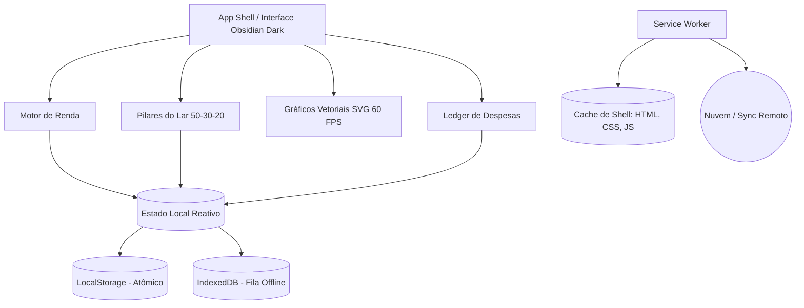

# Documentação Técnica e Arquitetura do Sistema

## Controlador Financeiro Doméstico PWA
*Documentação de engenharia de software, modelo de dados, matemática gráfica e arquitetura offline.*

---

## 1. Stack Tecnológica & Runtime de Execução

| Camada | Tecnologia | Justificativa Técnica |
| :--- | :--- | :--- |
| **Framework UI** | React 19 | Concorrência, Server/Client components, re-renders otimizados e hooks modernos. |
| **Estilização** | Tailwind CSS | Sistema de design atômico, paleta customizada Obsidian Dark Fintech e performance zero-runtime CSS. |
| **Ícones** | Lucide React | Conjunto iconográfico limpo, vetorial e de baixo peso em bundle. |
| **Persistência Primária** | LocalStorage API | Persistência atômica síncrona local para acesso imediato a dados sem latência. |
| **Fila de Mutação Offline** | IndexedDB API | Fila serializada de transações geradas quando o usuário estiver sem conexão à internet. |
| **Runtime PWA** | Service Worker + Web Manifest | Estratégia de cache híbrida (Cache-First para app shell e Stale-While-Revalidate para dados). |

---

## 2. Matriz de Atributos e Funcionalidades



| Módulo | Responsabilidade Técnica | Padrão de UX | Status |
| :--- | :--- | :--- | :--- |
| **Motor de Renda** | Cálculo dinâmico de renda líquida, saldo livre e taxa de comprometimento. | Edição direta no valor e modal rápido de ajustes de renda. | Em Produção |
| **Pilares do Lar** | Classificação tripartite: Fixas (50%), Supérfluos (30%) e Aportes (20%). | Banners com barras de saturação e deleção rápida. | Em Produção |
| **Gráficos Vetoriais** | Starburst 360° e Radar Harmônico Senoidal renderizados nativamente em SVG. | Animação contínua (Tick em 60 FPS) via `requestAnimationFrame`. | Em Produção |
| **Ledger de Despesas** | Tabela transacional com busca rápida, filtros por categoria e status de liquidação. | *Inline Click-to-Edit* com feedback visual imediato. | Em Produção |
| **PWA Offline Sync** | Cache de casca de aplicação e despacho de fila transacional no reconect. | Service Worker com cache-first e listener de rede `window.online`. | Pronto |

---

## 3. Esquema de Dados Principal (JSON Schema)

O estado da aplicação é serializável em JSON, permitindo exportação, importação e backup local.

### 3.1 Definição TypeScript dos Tipos
```typescript
export type CategoriaOrcamentaria = 'fixas' | 'superfluos' | 'investimentos';

export interface ItemLancamento {
  id: string;               // UUID v4 único
  titulo: string;           // Descrição sucinta da despesa/investimento
  categoria: CategoriaOrcamentaria;
  tipoDetalhado: string;    // Subcategoria padronizada (ex: 'Moradia', 'Streaming')
  valor: number;            // Valor monetário decimal em BRL
  vencimento: string;       // Formato textual de exibição (ex: 'Dia 10') ou ISO 8601
  pago: boolean;            // Status de liquidação da obrigação
}

export interface MetasRegra {
  fixas: number;            // Meta percentual (padrão: 50)
  superfluos: number;       // Meta percentual (padrão: 30)
  investimentos: number;    // Meta percentual (padrão: 20)
}

export interface EstadoFinanceiro {
  rendaFamiliar: number;    // Total líquido mensal disponível
  metasRegra: MetasRegra;
  itens: ItemLancamento[];
}
```

### 3.2 Exemplo Estruturado de Carga de Dados
```json
{
  "rendaFamiliar": 12500.00,
  "metasRegra": {
    "fixas": 50,
    "superfluos": 30,
    "investimentos": 20
  },
  "itens": [
    {
      "id": "item_uuid_01",
      "titulo": "Aluguel / Parcela Imobiliária",
      "categoria": "fixas",
      "tipoDetalhado": "Moradia",
      "valor": 3200.00,
      "vencimento": "Dia 10",
      "pago": true
    },
    {
      "id": "item_uuid_02",
      "titulo": "Reserva de Oportunidade (CDB)",
      "categoria": "investimentos",
      "tipoDetalhado": "Liquidez Diária",
      "valor": 1200.00,
      "vencimento": "Dia 05",
      "pago": false
    }
  ]
}
```

---

## 4. Mapeamento de Categorias e Impacto Orçamentário

A estrutura de categorias organiza os gastos familiares de acordo com o impacto no fluxo de caixa e estabelece uma hierarquia de corte orçamentário:

| Pilar | Categorias Detalhadas Sugeridas | Impacto no Fluxo de Caixa | Prioridade de Corte |
| :--- | :--- | :--- | :--- |
| **Contas Fixas** *(50%)* | Moradia, Alimentação Básica, Energia, Água, Telecomunicações, Saúde básica | Compromisso rígido mensal indispensável | **Baixa** *(Essencial à sobrevivência)* |
| **Supérfluos** *(30%)* | Restaurantes, Delivery, Assinaturas de Streaming, Vestuário, Viagens, Lazer | Variabilidade discricionária e estilo de vida | **Alta** *(Primeira linha de contenção em aperto financeiro)* |
| **Investimentos** *(20%)* | CDB Liquidez Diária, Tesouro Direto IPCA+, Ações, Fundos Imobiliários | Construção de patrimônio, reserva e autonomia futura | **Média** *(Preservar aporte mínimo prudencial de 10%)* |

---

## 5. Engenharia Gráfica e Matemática SVG

Para manter renderização suave a **60 FPS** sem dependências externas pesadas (como D3.js ou Three.js), a interface utiliza renderizadores nativos em SVG alimentados por equações trigonométricas orientadas por um ciclo contínuo de tempo (*tick*).

### 5.1 Equação dos Raios Radiais 360° (Starburst)
Cada raio $i$ do total de $N$ raios possui seu comprimento $L$ modulado pelo peso orçamentário relativo da categoria associada e por uma onda harmônica contínua:

$$\theta = \frac{i \times 360^\circ}{N}$$

$$L = \text{Base} + \left(\frac{\text{Peso}}{100} \times 36\right) + \sin\left(4\pi \times \frac{i}{N} + \text{tick}\right) \times 4$$

### 5.2 Ondas Orgânicas do Radar Harmônico Senoidal
O contorno vetorial fechado do radar gera 72 vértices interpolados em coordenadas polares, conferindo um efeito estético de "respiração líquida" do ecossistema financeiro:

$$r(\theta) = r_{\text{base}} + \sin(\theta \times \text{freq} + \text{offset}) \times \text{amplitude}$$

Conversão para o plano cartesiano bidimensional $(x, y)$:
$$x = cx + r(\theta) \times \cos(\theta)$$
$$y = cy + r(\theta) \times \sin(\theta)$$

---

## 6. Configuração PWA Manifest & Políticas de Cache

### 6.1 Manifesto de Instalação (`manifest.json`)
```json
{
  "name": "Gestor Financeiro do Lar",
  "short_name": "GestorLar",
  "start_url": "/",
  "display": "standalone",
  "background_color": "#07080b",
  "theme_color": "#00FF87",
  "icons": [
    {
      "src": "/icons/icon-192.png",
      "sizes": "192x192",
      "type": "image/png"
    },
    {
      "src": "/icons/icon-512.png",
      "sizes": "512x512",
      "type": "image/png"
    }
  ]
}
```

### 6.2 Estratégias do Service Worker
1. **Cache-First para Shell da Aplicação:**
   - Recursos estáticos (HTML principal, bundle JavaScript React, stylesheets Tailwind, fontes WOFF2 locais e ícones) são interceptados e servidos diretamente do cache local.
2. **Stale-While-Revalidate para Dados:**
   - Leituras ao storage local ocorrem instantaneamente na abertura da tela, enquanto rotinas assíncronas validam eventuais dados em background.
3. **Fila Transacional Offline via IndexedDB:**
   - Adições, edições e exclusões realizadas em modo offline são armazenadas em uma fila ordenada de mutações no IndexedDB.
   - Assim que o navegador emite o evento `window.addEventListener('online')`, a fila é descarregada e os registros são sincronizados.

---

## 7. Diretrizes de Segurança e Privacidade
- **Dados Locais por Padrão:** Todas as informações financeiras de valores e descrições residem inicialmente no dispositivo do usuário, garantindo sigilo bancário.
- **Preparação para Nuvem Segura (E2EE):** Qualquer futura camada de sincronização remota (Supabase/Firebase) deve aplicar criptografia ponta a ponta antes da transmissão.
