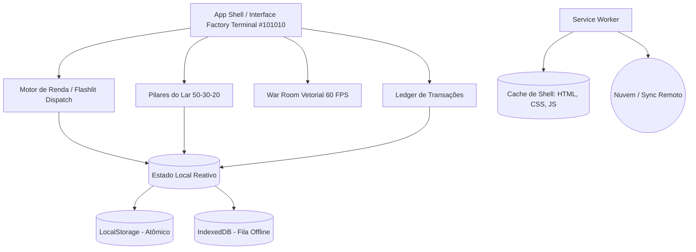

# Documentação Técnica e Arquitetura do Sistema

## Controlador Financeiro Doméstico PWA
*Documentação de engenharia de software, modelo de dados, matemática gráfica e arquitetura offline.*

---

## 1. Stack Tecnológica & Runtime de Execução

| Camada | Tecnologia | Justificativa Técnica |
| :--- | :--- | :--- |
| **Framework UI** | React 19 | Concorrência, Server/Client components, re-renders otimizados e hooks modernos. |
| **Design System** | Factory Style Reference | Terminal war room at midnight, canvas Obsidian `#101010`, dispatch card `#eeeeee`, Geist 400 e Geist Mono, zero sombras e bordas hairline de 1px. |
| **Estilização** | Tailwind CSS v4 | Sistema de design atômico com tokens nativos `@theme` e performance zero-runtime CSS. |
| **Ícones** | Lucide React | Conjunto iconográfico limpo, vetorial e de baixo peso em bundle. |
| **Persistência Primária** | LocalStorage API | Persistência atômica síncrona local para acesso imediato a dados sem latência. |
| **Fila de Mutação Offline** | IndexedDB API | Fila serializada de transações geradas quando o usuário estiver sem conexão à internet. |
| **Runtime PWA** | Service Worker + Web Manifest | Estratégia de cache híbrida (Cache-First para app shell e Stale-While-Revalidate para dados). |

---

## 2. Matriz de Atributos e Funcionalidades



| Módulo | Responsabilidade Técnica | Padrão de UX | Status |
| :--- | :--- | :--- | :--- |
| **Motor de Renda** | Cálculo dinâmico de renda líquida, saldo livre e taxa de comprometimento. | Edição direta no valor e modal rápido de ajustes de renda. | Em Produção |
| **Pilares do Lar** | Classificação tripartite: Fixas (50%), Supérfluos (30%) e Aportes (20%). | Banners com barras de saturação e deleção rápida. | Em Produção |
| **Gráficos Vetoriais** | Starburst 360° e Radar Harmônico Senoidal renderizados nativamente em SVG. | Animação contínua (Tick em 60 FPS) via `requestAnimationFrame`. | Em Produção |
| **Ledger de Despesas** | Tabela transacional com busca rápida, filtros por categoria e status de liquidação. | *Inline Click-to-Edit* com feedback visual imediato. | Em Produção |
| **PWA Offline Sync** | Cache de casca de aplicação e despacho de fila transacional no reconect. | Service Worker com cache-first e listener de rede `window.online`. | Pronto |

---

## 3. Esquema de Dados Principal (JSON Schema)

O estado da aplicação é serializável em JSON, permitindo exportação, importação e backup local.

### 3.1 Definição TypeScript dos Tipos
```typescript
export type CategoriaOrcamentaria = 'fixas' | 'superfluos' | 'investimentos';

export interface ItemLancamento {
  id: string;               // UUID v4 único
  titulo: string;           // Descrição sucinta da despesa/investimento
  categoria: CategoriaOrcamentaria;
  tipoDetalhado: string;    // Subcategoria padronizada (ex: 'Moradia', 'Streaming')
  valor: number;            // Valor monetário decimal em BRL
  vencimento: string;       // Formato textual de exibição (ex: 'Dia 10') ou ISO 8601
  pago: boolean;            // Status de liquidação da obrigação
}

export interface MetasRegra {
  fixas: number;            // Meta percentual (padrão: 50)
  superfluos: number;       // Meta percentual (padrão: 30)
  investimentos: number;    // Meta percentual (padrão: 20)
}

export interface EstadoFinanceiro {
  rendaFamiliar: number;    // Total líquido mensal disponível
  metasRegra: MetasRegra;
  itens: ItemLancamento[];
}
```

### 3.2 Exemplo Estruturado de Carga de Dados
```json
{
  "rendaFamiliar": 12500.00,
  "metasRegra": {
    "fixas": 50,
    "superfluos": 30,
    "investimentos": 20
  },
  "itens": [
    {
      "id": "item_uuid_01",
      "titulo": "Aluguel / Parcela Imobiliária",
      "categoria": "fixas",
      "tipoDetalhado": "Moradia",
      "valor": 3200.00,
      "vencimento": "Dia 10",
      "pago": true
    },
    {
      "id": "item_uuid_02",
      "titulo": "Reserva de Oportunidade (CDB)",
      "categoria": "investimentos",
      "tipoDetalhado": "Liquidez Diária",
      "valor": 1200.00,
      "vencimento": "Dia 05",
      "pago": false
    }
  ]
}
```

---

## 4. Mapeamento de Categorias e Impacto Orçamentário

A estrutura de categorias organiza os gastos familiares de acordo com o impacto no fluxo de caixa e estabelece uma hierarquia de corte orçamentário:

| Pilar | Categorias Detalhadas Sugeridas | Impacto no Fluxo de Caixa | Prioridade de Corte |
| :--- | :--- | :--- | :--- |
| **Contas Fixas** *(50%)* | Moradia, Alimentação Básica, Energia, Água, Telecomunicações, Saúde básica | Compromisso rígido mensal indispensável | **Baixa** *(Essencial à sobrevivência)* |
| **Supérfluos** *(30%)* | Restaurantes, Delivery, Assinaturas de Streaming, Vestuário, Viagens, Lazer | Variabilidade discricionária e estilo de vida | **Alta** *(Primeira linha de contenção em aperto financeiro)* |
| **Investimentos** *(20%)* | CDB Liquidez Diária, Tesouro Direto IPCA+, Ações, Fundos Imobiliários | Construção de patrimônio, reserva e autonomia futura | **Média** *(Preservar aporte mínimo prudencial de 10%)* |

---

## 5. Engenharia Gráfica e Matemática SVG

Para manter renderização suave a **60 FPS** sem dependências externas pesadas (como D3.js ou Three.js), a interface utiliza renderizadores nativos em SVG alimentados por equações trigonométricas orientadas por um ciclo contínuo de tempo (*tick*).

### 5.1 Equação dos Raios Radiais 360° (Starburst)
Cada raio $i$ do total de $N$ raios possui seu comprimento $L$ modulado pelo peso orçamentário relativo da categoria associada e por uma onda harmônica contínua:

$$\theta = \frac{i \times 360^\circ}{N}$$

$$L = \text{Base} + \left(\frac{\text{Peso}}{100} \times 36\right) + \sin\left(4\pi \times \frac{i}{N} + \text{tick}\right) \times 4$$

### 5.2 Ondas Orgânicas do Radar Harmônico Senoidal
O contorno vetorial fechado do radar gera 72 vértices interpolados em coordenadas polares, conferindo um efeito estético de "respiração líquida" do ecossistema financeiro:

$$r(\theta) = r_{\text{base}} + \sin(\theta \times \text{freq} + \text{offset}) \times \text{amplitude}$$

Conversão para o plano cartesiano bidimensional $(x, y)$:
$$x = cx + r(\theta) \times \cos(\theta)$$
$$y = cy + r(\theta) \times \sin(\theta)$$

### 5.3 Enquadramento dos Instrumentos e Badges do War Room (`HyperWaveCard`)
Para assegurar alinhamento e impedir compressão de elementos em telas de diferentes proporções:
1. **Rodapé Imutável (`shrink-0` e `h-9`):** O rodapé terminal dos instrumentos opera com altura fixa de 36px e prevenção de encolhimento flex (`shrink-0`), garantindo que a borda inferior arredondada do card nunca corte os rótulos de canal e os badges de telemetria.
2. **Badge Estruturado `LIVE STREAM`:** O indicador de fluxo contínuo foi estruturado em um badge dedicado (fundo Carbon `#1d1a18`, borda hairline em Metric Green `#a0ca92]/40`, tipografia Geist Mono e pulso de status ativo).
3. **Escalonamento Responsivo do SVG:** A área gráfica utiliza `flex-1` com altura adaptativa e viewBox otimizado, mantendo as amplitudes senoidais perfeitamente contidas.

### 5.4 Proporção e Alinhamento dos Botões Inline (`HeaderMotorRenda`)
1. **Geometria Equilibrada (`h-[38px] w-[38px] shrink-0`):** Os botões de confirmação (`Check`) e cancelamento (`X`) nos campos de edição inline da Renda e do Saldo Livre (card de despacho) foram redimensionados para formato quadrado de 38px, perfeitamente alinhados à altura do input `text-2xl`, eliminando achatamentos causados por herança de espaçamento.
2. **Iconografia e Contraste Reforçados:** Ícones renderizados com espessura nítida (`stroke-[2.5]`), preenchimento em contraste absoluto e estados de hover com transições mecânicas imediatas.

### 5.5 Barra Superior Responsiva sem Cortes (`HeaderMotorRenda nav`)
1. **Dimensionamento Compacto e Enquadramento Total:** A barra de navegação superior foi ajustada com espaçamentos fluidos (`gap-1 sm:gap-2 md:gap-3` e `px-1 sm:px-2`), garantindo que todos os 5 botões de comando (`Sync`, `Notificações`, `WhatsApp`, `Zerar Painel` e `Conectar Nuvem`) permaneçam 100% visíveis em telas mobile sem qualquer corte lateral.
2. **Rótulos Adaptativos:** Textos secundários adaptam-se aos breakpoints da tela (`min-[480px]` e `md:`), exibindo botões de ação com ícones bem demarcados no mobile e rótulos expandidos em tablets e desktops.

---

## 6. Configuração PWA Manifest & Políticas de Cache

### 6.1 Manifesto de Instalação (`manifest.json`)
```json
{
  "name": "Gestor Financeiro do Lar",
  "short_name": "GestorLar",
  "start_url": "/",
  "display": "standalone",
  "background_color": "#07080b",
  "theme_color": "#00FF87",
  "icons": [
    {
      "src": "/icons/icon-192.png",
      "sizes": "192x192",
      "type": "image/png"
    },
    {
      "src": "/icons/icon-512.png",
      "sizes": "512x512",
      "type": "image/png"
    }
  ]
}
```

### 6.2 Estratégias do Service Worker
1. **Cache-First para Shell da Aplicação:**
   - Recursos estáticos (HTML principal, bundle JavaScript React, stylesheets Tailwind, fontes WOFF2 locais e ícones) são interceptados e servidos diretamente do cache local.
2. **Stale-While-Revalidate para Dados:**
   - Leituras ao storage local ocorrem instantaneamente na abertura da tela, enquanto rotinas assíncronas validam eventuais dados em background.
3. **Fila Transacional Offline via IndexedDB:**
   - Adições, edições e exclusões realizadas em modo offline são armazenadas em uma fila ordenada de mutações no IndexedDB.
   - Assim que o navegador emite o evento `window.addEventListener('online')`, a fila é descarregada e os registros são sincronizados.

---

## 7. Diretrizes de Segurança e Privacidade
- **Dados Locais por Padrão:** Todas as informações financeiras de valores e descrições residem inicialmente no dispositivo do usuário, garantindo sigilo bancário.
- **Preparação para Nuvem Segura (E2EE):** Qualquer futura camada de sincronização remota (Supabase/Firebase) deve aplicar criptografia ponta a ponta antes da transmissão.

---

## 8. Arquitetura do Assistente por Voz e Reconhecimento de Fala Contínuo

### 8.1 Ciclo de Vida do Web Speech API (`SpeechRecognition`)
O assistente `FACTORY // COPILOT_TERMINAL.SYS` opera com reconhecimento de fala contínuo e em tempo real no navegador:
1. **Instanciação Estável (`useEffect` desvinculado de estado):** O `SpeechRecognition` é configurado uma única vez na montagem do componente, impedindo que atualizações intermediárias de transcrição abortem a escuta prematuramente.
2. **Modo Contínuo (`continuous = true`, `interimResults = true`):** A escuta permanece aberta durante micro-pausas do usuário enquanto fala números e comandos complexos (ex: *"Coloque 50 de almoço"*, *"Adiciona 100 de luz e 200 de mercado"*).
3. **Detector de Silêncio Inteligente (Auto-Submit):** Um timer de inatividade de 1.8 segundos após a última palavra detectada conclui a gravação e dispara a interpretação e atualização contábil sem necessidade de cliques manuais.
4. **Reconstrução Semântica e Limpeza de Stopwords:** O módulo `aiAssistantParser` sanitiza números por extenso e comandos coloquiais (*coloque*, *anota*, *lança*, *bota*, *de*, *no*, *reais*), extraindo o título categorizado e o valor numérico com precisão estrita.

### 8.2 Resolução de Pilares com Prioridade Máxima (`detectarPilarExplicito`)
Quando o usuário menciona explicitamente o destino orçamentário no comando de voz ou texto (ex: *"como supérfluo"*, *"gasto supérfluos"*, *"nas contas fixas"*, *"no pilar investimentos"*):
1. **Prioridade de Sobrescrita:** A determinação explícita do pilar sobrepõe as associações padrão de vocabulário (por exemplo, um gasto em *"mercado"* direcionado *"como supérfluo"* é alocado em `superfluos` como *Compras Gerais*, e não em *Contas Fixas*).
2. **Remoção de Falsos Positivos por Substring:** Eliminação de buscas parciais sem limite de palavra (como a palavra *"gasto"* casando indevidamente com o radical *"gas"* de Energia), garantindo casamento estrito por limites de palavra (`\b`).
3. **Higienização de Título:** Nomes de pilares (*supérfluo*, *fixo*, *investimento*) e preposições conexas (*como*, *no*, *nas*) são expurgados do título do lançamento, resultando em descrições limpas e profissionais (ex: *"Mercado"*, *"Luz"*, *"CDB"*).

### 8.3 Extração Inteligente de Vencimento e Eliminação de Vencimento Padrão Indevido
Para garantir que despesas faladas só apareçam no calendário quando o usuário realmente ditar uma data:
1. **Remoção do Padrão 'Dia 10':** Anteriormente, novos lançamentos sem menção explícita de prazo recebiam `'Dia 10'` por padrão, poluindo o calendário mensal indevidamente. Agora, itens sem menção de data recebem `vencimento: 'A definir'` e não são plotados em nenhum dia do calendário.
2. **Reconhecimento de Dias Falados (`extrairVencimentoFalado`):**
   - Identifica dias com prefixo (*"dia 10"*, *"pro dia 5"*, *"vence dia 22"*, *"no dia 8"*).
   - Identifica números por extenso (*"dia primeiro"*, *"dia quinze"*, *"dia trinta e um"*).
   - Identifica datas completas (*"15/11/2026"*).
3. **Desacoplamento de Valor Monetário vs. Dia:** A data é extraída e higienizada do texto antes do cálculo monetário, impedindo que comandos como *"Dia 5 almoço 40"* interpretem o 5 como valor do almoço.
4. **Proteção nos Motores de Calendário e Notificação:** `CalendarioPlanejamentoMensal`, `whatsappReminderService` e `firebaseNotificationService` filtram estritamente valores `'A definir'`, `'Sem vencimento'` ou strings genéricas, aceitando apenas datas formatadas ou dias explícitos no formato `"Dia X"`.

---

## 9. Mecanismo de Limpeza e Reinicialização Total do Painel (`zerarPainel`)

### 9.1 Operações de Limpeza
O sistema dispõe de rotina controlada para zerar o painel via interface ou comando de voz:
1. **Zerar Tudo (Renda e Gastos):** Redefine a renda familiar líquida para R$ 0,00 e purga todos os lançamentos do ledger local (`itens: []`), recalculando instantaneamente todos os KPIs para zero e propagando para a nuvem.
2. **Zerar Apenas Gastos:** Limpa todas as despesas e investimentos mantendo a renda líquida atual configurada.
3. **Modal de Confirmação (`ModalZerarPainel`):** Interface modal estilizada no Factory Design System com confirmação explícita de duas etapas para prevenir limpezas acidentais.
4. **Comando de Voz Integrado:** Capacidade do assistente IA interpretar frases como *"Zerar o painel"*, *"Limpar todo o painel"* ou *"Zerar tudo"*, executando a ação e fornecendo feedback falado e visual.

---

## 10. Módulo de Calendário e Planejamento Mensal (`CalendarioPlanejamentoMensal`)

### 10.1 Arquitetura e Engenharia do Planejador
O componente `CalendarioPlanejamentoMensal` implementa uma visão temporal do fluxo de caixa doméstico projetado para o mês selecionado:
1. **Navegação Temporal Universal:** Seletores de mês e ano (`<`, `Hoje`, `>`) com cálculo dinâmico da matriz de dias do mês, incluindo preenchimento dos dias pertencentes ao mês anterior e posterior para renderização de grade consistente de 7 colunas (DOM a SÁB).
2. **Parser Híbrido de Vencimentos (`extrairDiaDoVencimento`):**
   - *Datas Recorrentes:* Interpreta padrões textuais comuns como `"Dia 10"`, `"Dia 08"`, `"15"`, replicando os compromissos em todos os meses selecionados.
   - *Datas ISO 8601 e BR:* Interpreta `"AAAA-MM-DD"` e `"DD/MM/AAAA"`, vinculando obrigações exclusivamente ao ano e mês de ocorrência real.
3. **Painel de KPIs Mensais:**
   - **Total Previsto no Mês:** Soma total de todos os compromissos financeiros agendados para o mês em exibição.
   - **Quitado / Pago:** Volume financeiro já liquidado com percentual de adimplemento sobre o total previsto.
   - **Pendente a Vencer:** Montante em aberto aguardando liquidação.
   - **Pico de Vencimentos:** Identificação automática do dia de maior pressão de caixa no mês.
4. **Inspetor Interativo e Modal On-Screen do Dia:** Ao clicar em qualquer data que possua compromissos cadastrados (ou no botão *Abrir na Tela*), abre-se imediatamente uma janela modal no centro da tela (`ModalDespesasDia`) com o resumo financeiro daquela data, lista completa dos lançamentos, alternância de status de pagamento (*pago / pendente*), botão de envio de lembrete WhatsApp individual ou consolidado, exclusão com 1 clique e formulário rápido de novos agendamentos.
5. **Filtros por Pilar e Status 100% Visíveis no Mobile Sem Cortes:** Barra horizontal otimizada onde todos os 7 seletores operacionais (`TODOS`, `FIXAS`, `SUPÉRFLUOS`, `APORTES`, `TUDO`, `A PAGAR`, `PAGO`) aparecem simultaneamente na tela do smartphone sem cortes e sem necessidade de rolagem horizontal, utilizando paddings compactos (`px-1.5 min-[380px]:px-2`), omissão da legenda textual redundante em telas móveis e rótulos responsivos adaptativos para larguras ultra-estreitas.
6. **Ergonomia e Visibilidade Sob Demanda no Mobile:**
   - *Ocultação de Despesas no Grid Mobile:* Em telas móveis (`sm:hidden`), as células do calendário deixam de exibir pílulas de texto e valores que ficavam comprimidos e ilegíveis nas colunas estreitas de ~45px, substituindo-os por micro-dots cromáticos minimalistas indicando a existência de despesas cadastradas (verde para pago, laranja para supérfluo/pendente e branco para fixas).
   - *Abertura Imediata na Tela ao Clicar no Dia:* Ao tocar em qualquer dia com despesas, a célula recebe anel de destaque e o modal com a pauta completa de lançamentos daquela data surge imediatamente na tela, permitindo gerenciar tudo sem necessidade de rolagem ou esforço visual.

---

## 11. Sistema de Lembretes de Vencimento via WhatsApp (`whatsappReminderService`)

### 11.1 Arquitetura e Monitoramento Temporal
O subsistema `whatsappReminderService` monitora continuamente todas as despesas e compromissos do orçamento familiar para identificar contas a vencer ou com vencimento próximo:
1. **Detecção e Cálculo de Prazos (`calcularDataVencimento` e `analisarContasParaLembrete`):**
   - *Contas que Vencem Hoje:* Contas não quitadas cuja data ou dia de vencimento coincide com o dia atual (`diasRestantes === 0`).
   - *Contas Próximas ao Vencimento:* Contas não quitadas cujo vencimento ocorrerá dentro da janela de antecedência configurada pelo usuário (padrão: 3 dias).
   - *Contas Atrasadas:* Contas não quitadas cujo dia de vencimento já transcorreu no ciclo atual.
2. **Formatação Semântica de Mensagens:**
   - *Mensagem Consolidada:* Gera resumo estruturado com marcadores de prioridade (🔴 *VENCE HOJE*, ⏰ *VENCENDO NOS PRÓXIMOS DIAS*, ⚠️ *ATRASADAS*), agrupando valor individual, pilar orçamentário (50-30-20), total previsto e chamada para liquidação no GestorLar.
   - *Mensagem Individual por Item:* Permite disparar lembrete pontual focado em uma única conta.
   - *Mensagem por Dia do Calendário:* Permite enviar a pauta completa de pagamentos de uma data específica inspecionada no calendário.
3. **Disparo Direto para API do WhatsApp:**
   - Normaliza telefones brasileiros e internacionais (`55 + DDD + número`).
   - Aciona `https://api.whatsapp.com/send` ou `https://wa.me/` com texto pré-preenchido e codificado via `encodeURIComponent`, compatível com WhatsApp Web no Desktop e aplicativo móvel oficial (Android/iOS).
4. **Ocultação de Alertas Intrusivos:** O banner ativo de alertas de vencimento (`BannerLembreteWhatsApp`) e os contadores de alertas foram ocultados da interface principal, mantendo a experiência limpa e focada no orçamento.
5. **Central Exclusiva de Cadastramento de Números (`ModalLembretesWhatsApp`):** Interface modal dedicada exclusivamente ao cadastro, gerenciamento, ativação e teste de números de WhatsApp, sem poluição visual de abas ou alertas automáticos.

### 11.2 Cadastro e Gerenciamento de Números de WhatsApp (`DestinatarioWhatsApp[]`)
O sistema suporta cadastro dinâmico de múltiplos números telefônicos para famílias ou casais que compartilham o painel:
1. **Identificação e Vínculo:** Cada registro armazena nome identificador (ex: *Titular*, *Cônjuge*, *Familiar*), telefone com DDD e tipo de vínculo.
2. **Controle Individual de Ativação:** Cada contato possui um seletor rápido para ativar ou desativar o número individualmente.
3. **Validação com Mensagem de Teste:** Botão de teste direto que abre o WhatsApp com mensagem de verificação para validar a conectividade do número cadastrado.

---

## 12. Sistema de Autenticação Individual e Isolamento Multi-Usuário

### 12.1 Arquitetura e Engenharia de Acesso (`authService.ts`)
Para assegurar que cada usuário do aplicativo gerencie seu próprio orçamento com privacidade e integridade absolutas, foi desenvolvida uma camada híbrida de autenticação e isolamento multi-inquilino (*multi-tenant*):
1. **Modelo Híbrido Resiliente (Supabase Auth + Fallback Local Offline):**
   - **Autenticação Online via Supabase Auth:** Realiza login e registro seguro com e-mail e senha por meio de `signInWithEmail` e `signUpWithEmail` na nuvem Supabase, emitindo tokens JWT protegidos e mantendo sessão criptografada.
   - **Fallback Local Autônomo:** Em situações de ausência de conexão à internet ou indisponibilidade da API, o módulo valida e persiste credenciais no `localStorage` sob a chave `gestorlar_usuarios_registrados`, garantindo que o usuário consiga acessar seus dados sem travas ou bloqueios mesmo completamente desconectado.
2. **Isolamento Estrito de Dados por Usuário (`userId` Scoping):**
   - Cada usuário autenticado possui um identificador único exclusivo (`user.id` no Supabase ou `usr_${timestamp}_${hash}` no modo local).
   - O hook primário de armazenamento `useFinanceStorage(userId)` isola a chave de armazenamento local (`gestor_financeiro_pwa_usr_${userId}`), impedindo colisões de dados quando diferentes usuários utilizam o mesmo dispositivo ou navegador.
   - Todas as operações em nuvem (`carregarDadosNuvem`, `migrarDadosLocaisParaNuvem`, `sincronizarPerfilNuvem`, `sincronizarItemNuvem`, `removerItemNuvem`, `inscreverTempoRealNuvem`) transmitem o `userId` específico, isolando tabelas e canais do Supabase Realtime por inquilino.

### 12.2 Interface de Acesso Factory Terminal (`TelaAutenticacao.tsx`)
1. **Estética Factory Dark Terminal:** Design integrado com `#101010` (Canvas Obsidian), `#161413` (Container), bordas `#3d3a39`, acento `#ee6018` e tipografia Geist Mono uppercase.
2. **Modos Entrar e Criar Conta:** Alternância fluida entre login direto e cadastro de novo usuário com confirmação de senha e campo opcional de nome.
3. **Segurança de Entrada:** Alternador de visibilidade de senha (*Eye/EyeOff*), validação de e-mail sintático, tamanho mínimo de senha e mensagens contextuais de erro e sucesso.

### 12.3 Indicador de Sessão e Encerramento (`HeaderMotorRenda.tsx`)
1. **Badge do Usuário Ativo:** Exibe o nome ou e-mail do usuário conectado no topo direito da barra de comandos com indicador luminoso de origem (*Nuvem* em verde `#a0ca92` ou *Local* em laranja `#ee6018`).
2. **Ação Rápida de Logout (`Sair`):** Botão discreto com ícone `LogOut` que encerra a sessão ativa (`fazerLogout`), limpa a sessão local e redireciona de imediato para a tela de autenticação.

---

## 13. Enquadramento e Anti-Overflow de Métricas no War Room

### 13.1 Otimização de Densidade e Contenção Estrita (`HyperWaveCard`)
1. **Eliminação de Vazamento Numérico:** Correção do estouro visual onde valores monetários extensos (ex: `R$ 30.000,00` na *Projeção 12M*) ultrapassavam a borda direita do container no banner superior.
2. **Escala Tipográfica Fluida e Truncamento Seguro:**
   - Redimensionamento adaptativo (`text-base sm:text-lg lg:text-[19px] xl:text-[21px]`) em substituição ao valor estático de 28px.
   - Aplicação de `truncate` com tooltip acessível (`title={formatarBRL(...)}`) para garantir que mesmo números de 7 ou 8 dígitos nunca rompam as bordas do card.
   - Aplicação de `min-w-0` em todas as colunas do grid CSS e containers flexíveis, eliminando o comportamento padrão do CSS Grid que impede células de encolherem abaixo da largura intrínseca do conteúdo.
3. **Paddings Proporcionais e Ícones com Shrink-0:**
   - Ajuste dos paddings para `px-3.5 py-3 sm:px-4 sm:py-3.5` (liberando +16px de largura útil por coluna).
   - Fixação de `shrink-0` nos botões de edição inline (`Edit2`) para evitar compressão contra o texto monetário.
4. **Alinhamento Harmônico nos Demais Cards (`HyperRadarCard` e `HyperStarburstCard`):**
   - Padronização idêntica de contenção, `min-w-0` e tipografia adaptativa em todos os cards da suíte vetorial do War Room.

---

## 14. Correção Estrutural da Barra Superior e Normalização de Espaçamentos Tailwind v4

### 14.1 Diagnóstico de Causa Raiz no Motor Tailwind CSS v4 (`src/index.css`)
1. **Colisão de Multiplicadores do `@theme`:** A introdução acidental de propriedades `--spacing-8: 8px;`, `--spacing-16: 16px;`, `--spacing-24: 24px;` no bloco `@theme` alterou o comportamento interno do motor do Tailwind v4:
   - Em Tailwind v4, definir `--spacing-16: 16px` sobrescreve o valor do utilitário `h-16` / `w-16` (que originalmente representaria `4rem` / `64px`) para um valor fixo de apenas `16px`.
   - Similarmente, `--spacing-8: 8px` colapsava qualquer utilitário `h-8` para meros 8px, causando deformação achatada nos botões de confirmação e cancelamento inline.
2. **Sintoma da Linha Atravessando Ícones e Comandos:**
   - Com `<nav className="h-16 ... border-b border-[#3d3a39]">`, o container da barra de navegação superior foi forçado a uma altura estática de apenas 16px.
   - Como os botões internos de ação (`Sync`, `WhatsApp`, `Zerar`, `Nuvem`, `Sair`) medem 34px de altura (`h-[34px]`), a linha de borda inferior (`border-b`), fixada na coordenada Y de 16px a partir do topo, cortava horizontalmente o centro de todos os botões e ícones.

### 14.2 Resolução e Blindagem Arquitetural
1. **Expurgo de Tokens de Espaçamento Conflitantes:** Remoção completa das declarações arbitrárias de `--spacing-*` do `@theme` em `src/index.css`, restabelecendo a escala proporcional nativa do Tailwind.
2. **Contenção Flexível Adaptativa (`HeaderMotorRenda.tsx`):**
   - Substituição da classe rígida `h-16` por `min-h-[56px] py-2 sm:py-2.5`.
   - Garantia matemática de que a altura da barra sempre acomoda os 34px dos botões com no mínimo 8px de respiro acima e abaixo, posicionando a linha de borda `border-b` estritamente no rodapé da barra, abaixo de qualquer elemento visual.
3. **Normalização Simétrica dos Botões Inline:**
   - Botões de confirmação (`Check`) e cancelamento (`X`) configurados com dimensões fixas de `h-[38px] w-[38px] shrink-0` e alinhamento centralizado com cursores e estados interativos consistentes.
   - Prevenção de quebra de linhas nas seções de navegação em telas intermediárias com `hidden 2xl:flex` e `whitespace-nowrap`.

---

## 15. Ocultação de Alertas do WhatsApp e Central de Cadastro de Números

### 15.1 Ocultação dos Alertas e Notificações de Vencimento
1. **Remoção do Banner Superior:** O banner de notificação de contas pendentes (`BannerLembreteWhatsApp`) foi removido da tela inicial em `App.tsx`, eliminando alertas visuais intrusivos sobre o orçamento.
2. **Eliminação do Contador na Barra de Comandos:** O badge numérico laranja de alertas sobre o ícone do WhatsApp no `HeaderMotorRenda.tsx` foi removido, mantendo o botão limpo e discreto apenas com ícone e rótulo.
3. **Desativação de Disparos em Segundo Plano:** O efeito de disparo diário automático em background foi desativado em `App.tsx`.

### 15.2 Redesenho Exclusivo do Modal de Cadastramento de Números (`ModalLembretesWhatsApp`)
1. **Foco Estrito no Cadastramento:** O modal foi reformulado para eliminar abas secundárias (`Contas a Vencer` e `Automação Diária`), apresentando diretamente a interface limpa e focada de **Cadastro de Números de WhatsApp**.
2. **Formulário Ágil:** Cadastro imediato com campos de Identificação/Nome, WhatsApp com DDD e Vínculo (Titular, Cônjuge, Familiar, Outro) com botão de salvar de alta ênfase no padrão Factory.
3. **Gerenciamento de Destinatários:** Lista clara dos números cadastrados com alternador de ativação/desativação, botão para teste instantâneo de conectividade e exclusão direta.
