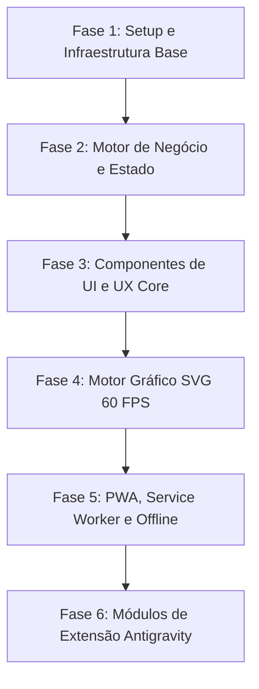

# Roteiro de Implementação e Passos de Execução (Roadmap)

## Controlador Financeiro Doméstico PWA
*Guia passo a passo para desenvolvimento, testes e extensão no ecossistema Antigravity.*

---

## 1. Visão Geral do Plano de Ação

---

## 2. Detalhamento das Fases de Execução

### Fase 1: Setup e Infraestrutura Base
- [ ] **1.1 Inicialização do Projeto:**
  - Configurar projeto React 19 com Vite e TypeScript.
  - Instalar dependências essenciais: `lucide-react`, `clsx`, `tailwind-merge`.
- [ ] **1.2 Configuração do Tailwind CSS:**
  - Definir tokens de design da paleta **Obsidian Dark Fintech**:
    - Fundo base: `#07080b`
    - Painéis/Cards: `#0f1117`, `#181b24`
    - Acentos: Verde Esmeralda `#00FF87`, Azul Ciano `#00D2FF`, Roxo `#9D00FF`
    - Texto: `#F3F4F6`, `#9CA3AF`, `#4B5563`
- [ ] **1.3 PWA Shell e Manifest:**
  - Criar `manifest.json` com nome `Gestor Financeiro do Lar` e `standalone`.
  - Configurar meta tags no `index.html` para suporte mobile iOS/Android (Apple Mobile Web App Capable, status bar preta).

---

### Fase 2: Motor de Negócio e Gestão de Estado
- [ ] **2.1 Tipagem e Schemas:**
  - Declarar interfaces `ItemLancamento`, `MetasRegra`, `EstadoFinanceiro` em `src/types/finance.ts`.
- [ ] **2.2 Motor de Cálculo da Regra 50-30-20:**
  - Implementar utilitários que calculam em tempo real:
    - Total de despesas fixas e desvio em relação aos 50% de meta.
    - Total de gastos supérfluos e desvio em relação aos 30% de meta.
    - Total de investimentos e percentual atingido sobre a meta de 20%.
    - Saldo livre remanescente e taxa de comprometimento da renda.
- [ ] **2.3 Hook de Persistência Atômica:**
  - Criar hook `useFinanceStorage` para sincronizar leituras e gravações no `localStorage` com debounce e integridade de dados.

---

### Fase 3: Componentes de UI e UX de Alta Densidade
- [ ] **3.1 Header & Motor de Renda:**
  - Exibição de Renda Total Familiar Líquida com indicador de saldo livre e percentual comprometido.
  - Modal ou inline click para ajuste rápido da renda base.
- [ ] **3.2 Pilares do Lar (Cards Tripartites):**
  - **Pilar Fixas (50%):** Barra de progresso, total alocado vs. teto, badge de status de saúde orçamentária.
  - **Pilar Supérfluos (30%):** Alerta visual em caso de estouro de meta discricionária.
  - **Pilar Investimentos (20%):** Medidor de aportes e reserva de oportunidade.
- [ ] **3.3 Ledger de Despesas (Tabela Interativa):**
  - Campo de busca instantânea por título ou tipo detalhado.
  - Filtro rápido por pilar (`Todos`, `Fixas`, `Supérfluos`, `Investimentos`) e por status (`Pago` / `Pendente`).
  - **Click-to-Edit Inline:** Permitir clicar em valor, título ou vencimento e editar sem abrir janelas extras.
  - Botão de deleção rápida com confirmação instantânea.

---

### Fase 4: Motor de Renderização Gráfica SVG 60 FPS
- [ ] **4.1 Loop de Animação Contínua (Tick Loop):**
  - Implementar hook `useAnimationFrame` para atualizar variável contínua de fase `tick` sincronizada com a taxa de atualização da tela.
- [ ] **4.2 Gráfico Starburst 360°:**
  - Renderizador vetorial SVG calculando raios com a fórmula:
    $$\theta = (i \times 360^\circ) / N$$
    $$L = \text{Base} + (\text{Peso} / 100) \times 36 + \sin(4\pi \times (i/N) + \text{tick}) \times 4$$
- [ ] **4.3 Radar Harmônico Senoidal Orgânico:**
  - Geração de 72 vértices interpolados polares com visual de onda fluida e respiração contínua:
    $$r(\theta) = r_{\text{base}} + \sin(\theta \times \text{freq} + \text{offset}) \times \text{amplitude}$$
  - Fechamento de path SVG com gradientes e blur sutil.

---

### Fase 5: Suporte Offline Total e Service Worker
- [ ] **5.1 Service Worker (Cache-First Shell):**
  - Registrar Service Worker no ciclo de inicialização do app.
  - Armazenar em cache o app shell, estilos e fontes para carregamento instantâneo offline.
- [ ] **5.2 Gerenciamento de Conectividade:**
  - Escuta ativa dos eventos `window.addEventListener('online')` e `window.addEventListener('offline')`.
  - Toast discreto informando estado de conexão (*"Modo Offline Ativo - Operando Localmente"*).
- [ ] **5.3 Fila Transacional IndexedDB:**
  - Armazenar mutações pendentes caso ocorra falha de rede e sincronizar ao restabelecer o sinal.

---

### Fase 6: Roteiro de Extensão Antigravity

Conforme especificado no item 6 do blueprint executivo, as próximas fases de expansão contemplam:

| Passo | Objetivo | Detalhamento Técnico | Complexidade |
| :--- | :--- | :--- | :--- |
| **Passo 01** | **Importação de Extrato OFX/CSV** | Parser client-side para converter arquivos de extrato de bancos brasileiros (*Nubank, Itaú, Inter*) diretamente nos objetos do schema de itens. | Média |
| **Passo 02** | **Projeção Patrimonial FIRE** | Simulador de juros compostos calculando anos estimados para independência financeira baseados na taxa média de aporte do pilar 3 (Investimentos). | Baixa |
| **Passo 03** | **Sincronização em Nuvem Privada** | Integração com camada Supabase ou Firebase com criptografia ponta a ponta (E2EE) das informações orçamentárias familiares. | Avançada |
| **Passo 04** | **Relatórios Automatizados em PDF** | Rotina automática de compilação de balancete mensal em PDF para exportação ou arquivamento. | Concluído / Integrar |

---

## 3. Critérios de Aceitação e Checklist de Qualidade

1. **Performance:** Carregamento inicial em menos de 1 segundo e animações gráficas rodando a 60 FPS estáveis.
2. **Resiliência Offline:** Fechar a aba, desconectar a internet, abrir novamente e continuar editando e salvando lançamentos normalmente.
3. **Fidelidade à Metodologia 50-30-20:** Totalizadores matemáticos e barras de limites atualizados em tempo real a cada caractere digitado.
4. **Ergonomia Mobile:** Toques confortáveis, botões de ação rápida e interface totalmente adaptada a telas de smartphones e desktops.
